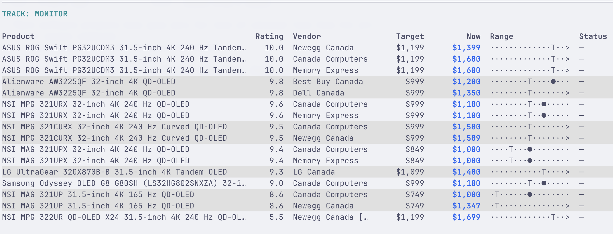

# Muninn

A cache-first, local CLI for watching product prices. It is designed for occasional sale-season use: product configuration, fetched HTML, and SQLite price history all live in the current project directory.



## Install

```sh
uv venv --python 3.14
source .venv/bin/activate
uv pip install -e '.[dev]'
uv run pytest -q

mkdir -p tracks/monitor
cp product.yaml.example tracks/monitor/my-monitor.yaml
# edit tracks/monitor/my-monitor.yaml
muninn check monitor
```

`check` fetches a URL only when its configured freshness window has expired (default: `2h` after a successful fetch, `1h` after a failed fetch). HTML is saved under `.muninn/v1/pages/`; all price observations and failed fetches are retained in `.muninn/v1/history.sqlite3`. On its first run, Muninn moves an existing `.snipe/v1/` cache into this new location.

If refreshing fails, Muninn reports the last successful price and warns that it is stale. It never replaces a valid cached page with a failed response. During interactive checks, progress uses one updating line on stderr (including cache hits, refreshes, and failures), while the final report remains on stdout. When stderr is redirected (for example, from cron), each progress event is written as a separate line for useful logs.

## Track and product configuration

A **track** is a class of purchase (for example, NVMe drives or monitors). Each track is a subdirectory of `./tracks/`, containing one YAML file for each viable product candidate; see `product.yaml.example`.

```text
tracks/
  nvme/
    track.yaml
    lexar-nm790-4tb.yaml
    wd-black-sn7100-4tb.yaml
  monitor/
    candidate-one.yaml
```

```sh
muninn check nvme monitor  # named tracks
muninn nvme monitor        # `check` is optional
muninn                     # check every track directory
```

Use `--tracks-dir path` to use a different directory. Each retailer entry needs a `name` and `url`. Built-in HTML extractors cover Amazon, Best Buy Canada, Canada Computers, Dell Canada, Newegg Canada, and Memory Express. `price_selector` is an optional CSS-selector override for a site whose markup changes. The selector's text must contain the displayed price. For marketplace listings, add optional `seller` and `seller_type: third_party` (or `first_party`); third-party listings are marked `[3P]` in reports.

Durations accept positive `m`, `h`, or `d` values, such as `30m`, `2h`, or `1d`. `refresh_after` controls the interval after a successful fetch (default `2h`); `retry_after` controls the interval after a failed fetch (default `1h`). Either may be set at product level and overridden for an individual retailer. Target prices are met at or below the configured amount. Add optional `notes` as a string or list of strings for buying rationale, tradeoffs, or things to watch; these appear as wrapped bullets in the product details.

## Report indicators

Each track begins with a cross-product retailer comparison sorted by desirability
(highest first), then current price (lowest first) within each rating. Unrated
products sort after rated ones; missing prices sort last within a rating. The
`Rating` column is shown in the overview, including `--short` mode. In `--long` mode each product also has a retailer table, a Product Details section for its rating and notes, and separate vendor sections with the full vendor URL, observation count, and numeric low/high. Vendor URLs and cache timestamps are shown dimmed so URLs remain easy to click or copy.

- `TARGET MET!` — current price is at or below the product target.
- `NEW LOW!` — current price is the lowest successful observation stored for that URL.
- `↓ $…` / `↑ $…` — change from the preceding successful observation.

Use normal scheduling (for example cron) to run `muninn`; the freshness window prevents unnecessary requests. Interactive reports use colour and bold emphasis by default; piped/cron output is plain. Override this with `--color always` or `--color never`.

Reports default to `--short`: only the overall comparison table for each track,
without any per-product subsections.
Use `muninn check nvme --long` to include per-product tables, Details, and notes,
or `--short` to explicitly
select the default. These flags are mutually exclusive; warnings are collected in a single section at the end in either mode.

For a spreadsheet-like visual separation in the short report, use `--zebra`. It
shades every other product with `#E0E0E0`, a light grey suited to light backgrounds.
All retailer rows for a product share the same background.
Choose a specific background with `--zebra COLOR`, using an ANSI
colour name (such as `blue` or `bright_black`), a palette index from `0` to
`255`, or a true-colour value such as `#303030`. Zebra shading is opt-in and
only appears when terminal colour is enabled; it is omitted from `--long`
reports.

## Optional browser fetching

HTTP is the default. For retailers needing rendered HTML, install the optional
browser dependency and Chromium:

```sh
uv pip install -e '.[dev,browser]'
python -m playwright install chromium
```

Select it per retailer:

```yaml
retailers:
  - name: Amazon Canada
    url: https://www.amazon.ca/dp/B0C4KQ9N79
    fetcher: browser
```

`src/muninn/browser.py` isolates the Playwright implementation. `fetcher: browser`
runs Chromium headlessly only for due refreshes, retains cookies in
`.muninn/v1/browser-profile/`, and saves rendered HTML through the same cache as
HTTP. Known challenges/timeouts become failed fetches with stale-price fallback.

For retailers such as Memory Express that only occasionally challenge a browser,
use `fetcher: browser_interactive`. It first uses the persistent profile headlessly;
only when the retailer requests verification does it reopen visibly and pause in
the terminal. Complete the normal retailer verification, then press Enter for Muninn
to read and cache the rendered price. It does not solve or bypass challenges.
Give these links a longer refresh window, for example:

```yaml
  - name: Memory Express
    url: https://www.memoryexpress.com/Products/MXEXAMPLE
    fetcher: browser_interactive
    refresh_after: 24h
```

Use `fetcher: interactive` when every browser fetch should be visible. Browser
fetching is best-effort, not a guarantee against retailer blocking. Do not run
simultaneous checks sharing the same browser profile. The profile
contains cookies: keep `.muninn/` private and ignored by Git.

Switch back to `fetcher: http` (or remove the field) to disable browser fetching.
Changing fetchers does not bypass the normal refresh delay. A failed interactive or browser-interactive attempt instead uses its `retry_after` delay (one hour by default).

### Manually refresh selected URLs

Use `reset` to make configured URLs eligible for their next check immediately. It preserves observations and cached pages; it only moves the latest attempt timestamp into the past.

```sh
muninn reset nvme                    # all configured retailers in the nvme track
muninn reset nvme --vendor newegg.ca # just Newegg URLs in that track
muninn reset --vendor newegg.ca      # Newegg URLs across every track
muninn check nvme                    # performs the now-due fetches
```

## Candidate desirability

Set optional `desirability: 9.5` in a product YAML (a finite number from 0 to 10).
This is your subjective preference, not a measured performance score. Rating is
the primary overview sort key; price breaks ties. Existing files without ratings
remain valid.

A candidate awaiting verified listings may use `retailers: []`. It appears as
`NO LINKS` and emits a warning rather than preventing the rest of the track from
running. Add exact product URLs when found; do not use search-result URLs as
price sources. Availability comments in notes are not live inventory checks.

## Vendor rate limiting

`--vendor-delay SECONDS` sets the minimum interval between top-level fetch starts
for the same vendor (default **2 seconds**; fractional values accepted).

```sh
muninn check nvme --vendor-delay 5
```

The last start time is persisted in `.muninn/v1/history.sqlite3`, shared by all
tracks and subsequent runs in that project. Vendor identity comes from the URL's
hostname, not its configurable display name; known retailer subdomains share a
bucket. HTTP and browser fetches use the same limiter. Cache hits never wait or
update the timestamp, and failed fetch attempts count. Time already spent fetching
counts toward the interval. `--vendor-delay 0` disables waiting.

This spaces product fetches, not every browser asset request, redirect, or
interstitial click. Separate projects have separate limiters. SQLite coordinates
claims across processes, but concurrent runs sharing a browser profile are still
not supported. If simultaneous runs use different delays, each enforces its own.

## Price range graphic

Displayed amounts round to whole dollars (half-up); history, comparisons, targets,
and sorting retain exact cents. Tables show Target, Now, and a **17-character**
Range graphic instead of numeric Low/High columns. Numeric extremes appear in
`--long` Details per retailer.

- `●`: current price; `T`: target.
- `├─┤`: observed low-to-high interval; `·`: outside that interval to include a target.
- `◎`: current and target occupy the same graphic cell (not necessarily exactly equal).
- Current/target markers take precedence over endpoints when they overlap.
- A flat history has no interval line; missing history shows `—`.

Every row shares a fixed scale, defaulting to **$500–$1,000**, including in
`--long` product tables. Set persistent bounds for a track in
`tracks/<track>/track.yaml` (the legacy-friendly name `config.yaml` is also
accepted):

```yaml
# tracks/nvme/track.yaml
range_min: 500
range_max: 900
```

This file is separate from product YAML files, leaving room for future track-wide
settings. A command-line bound overrides that one value for every selected track:

```sh
muninn check nvme --range-max 950
```

Bounds must be finite, non-negative numbers, with minimum strictly below maximum.
Use `--legend` to print the scale and Range graphic explanation. Prices and targets outside the scale
are clamped to the edges and indicated by `<` or `>`; these overflow indicators
take precedence over other edge markers. Historical extremes also count, so an
arrow can indicate an older outlier even when the current price is inside the
scale. Numeric prices remain unclamped; exact values are preserved in history.
Marker positions use exact amounts, not rounded display prices. The graphic is an
approximate positional aid, not a time-series chart; only the numeric comparison
controls `TARGET MET!`.
