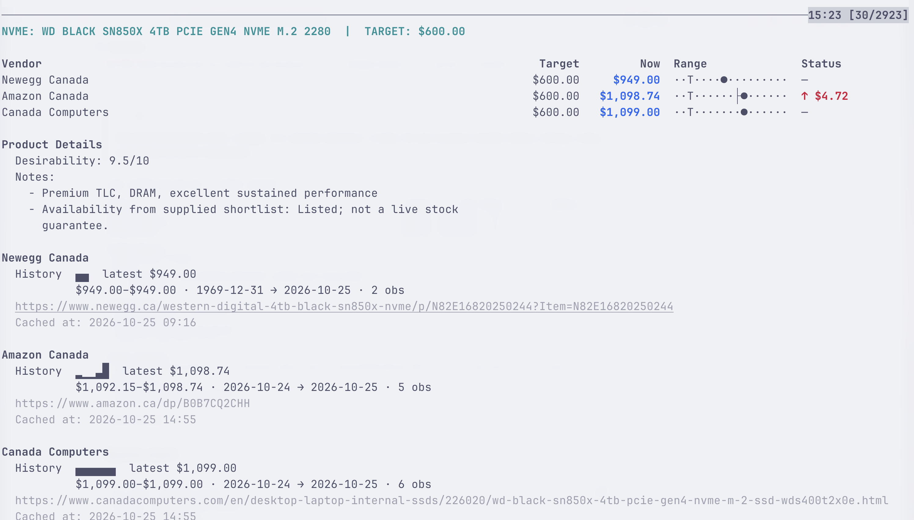

# Muninn

A cache-first CLI for watching product prices. Keep product lists, cached pages, and SQLite price history locally; compare retailers and spot target prices and new lows.


<br>

> [!TIP]
> **See the full picture with `--long`**: run `muninn monitor --long` for per-product retailer tables, ratings, notes, and historical price lows/highs.



## Quick start

```sh
uv venv --python 3.14
source .venv/bin/activate
uv pip install -e .

mkdir -p tracks/monitor
cp product.yaml.example tracks/monitor/my-monitor.yaml
# Edit the YAML with your product and retailer URLs.
muninn check monitor
muninn check monitor --force   # Refresh now, regardless of cache age
```

A **track** groups purchase candidates (such as monitors or NVMe drives). Each product gets a YAML file under `tracks/<track>/`; see [the example configuration](product.yaml.example).

## Everyday usage

```sh
muninn                         # Check all tracks
muninn nvme monitor            # Check selected tracks
muninn monitor --long          # Include product details and price history
muninn monitor --legend        # Explain the price-range graphic
muninn reset monitor           # Make URLs due for refresh on the next check
```

Checks reuse cached results for two hours by default and retry failed fetches after one hour. If a refresh fails, the last successful price is shown with a stale warning. Data lives in `.muninn/`—keep it private and ignored by Git.

Built-in extractors support Amazon, Best Buy Canada, Canada Computers, Dell Canada, Newegg Canada, and Memory Express. Optional browser fetching handles sites that need rendered HTML or manual verification. For Newegg Canada, Best Buy Canada, and Memory Express, `fetcher: bridge` collects pages in your existing Firefox session through the optional local extension (see usage reference). For other sites that block automation, use `fetcher: manual` and import HTML saved from your normal browser with `muninn import --url URL --html FILE`.

See the **[usage reference](docs/usage.md)** for configuration, browser setup, report indicators, range scales, rate limiting, and refresh controls.

## Interactive results viewer

```sh
uv pip install -e '.[tui]'
muninn --tui                  # Browse all tracks; first track opens immediately
muninn --tui monitor nvme     # Browse selected tracks
```

The optional Textual viewer reads **cached data only**. Switch tracks in the left
sidebar (`t`), select a retailer row with arrows/mouse, and press Enter to open
a detailed report for that vendor, including product notes and full price history.
Escape returns, `m` toggles missing-price rows, `r` reloads
the cache, and `q` quits. Refresh separately with `muninn check`. On macOS,
light/dark themes automatically follow system appearance (within five seconds).

## Development

```sh
uv pip install -e '.[dev,tui]'
uv run pytest -q
```
